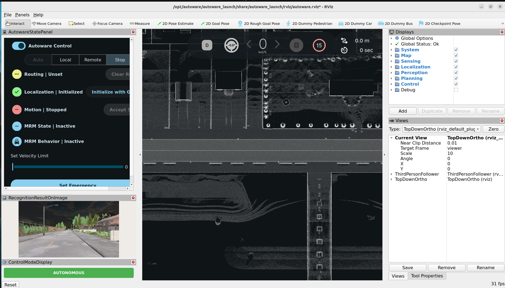
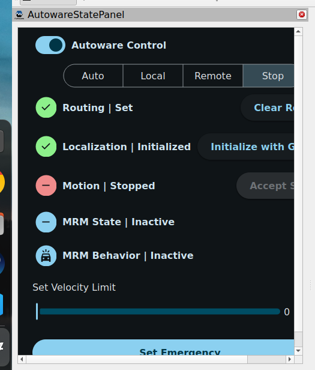
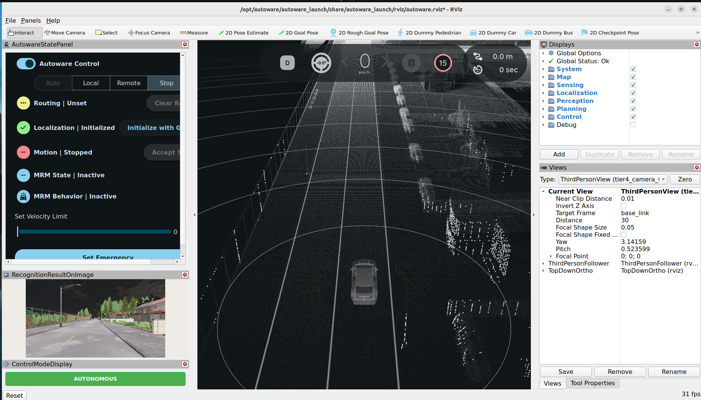
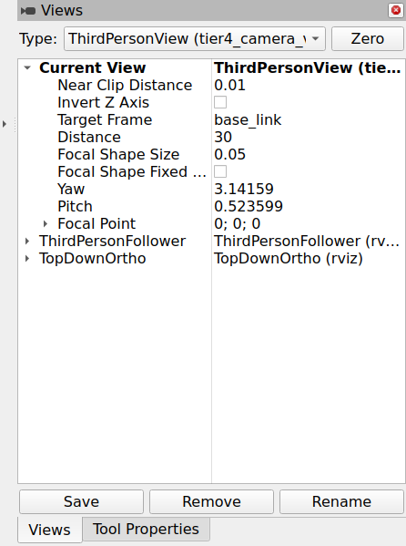
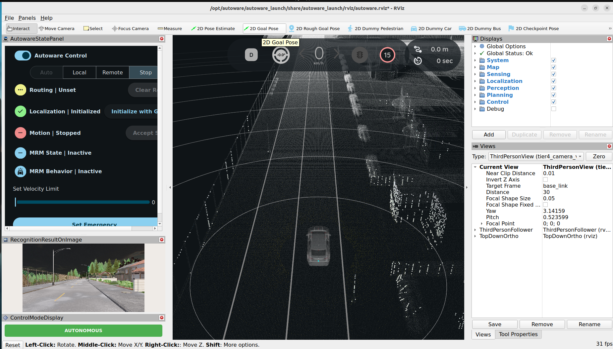
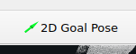
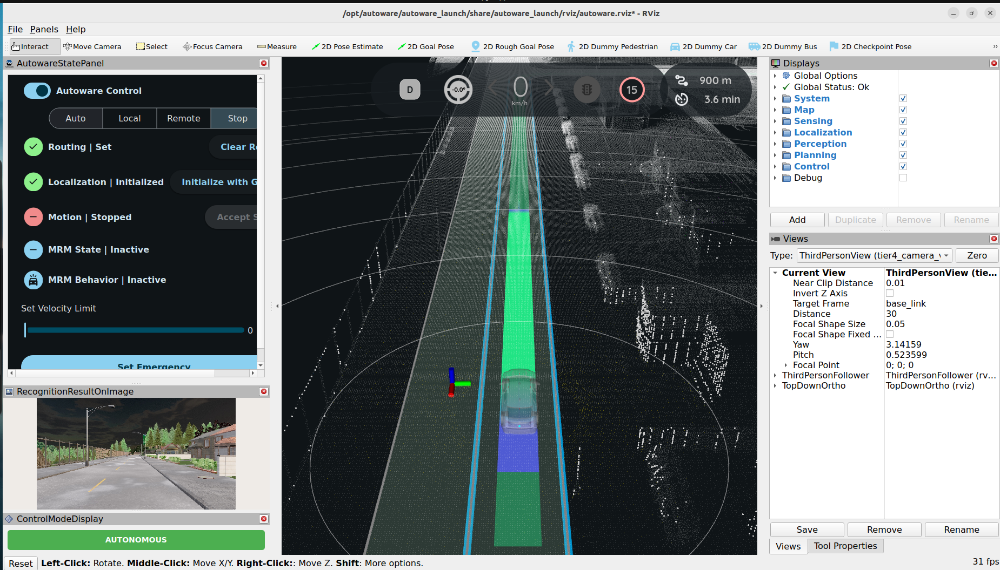
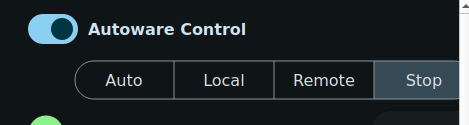

# Autonomous Driving Simulation Environment (Autoware + CARLA + Docker)

## 📌 概要 (Overview)

本プロジェクトは、オープンソースの自動運転ソフトウェア「Autoware」と、高精度なオープンソース自動運転シミュレーター「CARLA」を連携させ、Dockerコンテナ上でGPUを活用して動作させるための統合シミュレーション環境です。

複雑な依存関係や環境構築のハードルをDockerによって解消し、ホストマシンのNVIDIA GPUを用いた高速なレンダリングおよび演算処理（ROS 2通信を含む）を、どのマシンでも再現性高く構築・実行できるようにします。

---

## 🎯 目的 (Objective)

1. **環境構築の簡素化**: AutowareとCARLAの複雑なビルド・依存関係のトラブルを避け、Dockerを用いた迅速な環境構築を実現する。
2. **ハードウェアアクセラレーションの活用**: NVIDIA GPUをコンテナ内からフル活用し、リアルタイム性の高いシミュレーション（センサシミュレーションやAI推論など）を安定して行う。
3. **自動運転アルゴリズムの検証**: 実車検証前の安全かつ効率的なテストベッドとして、Autowareによる自己位置推定、経路計画、制御などの挙動をバーチャル空間上で検証・評価する。

---

## 📌 バージョン・依存関係 (Versions & Prerequisites)

本環境で使用している主要なソフトウェアのバージョンおよびイメージです。

| コンポーネント | バージョン / イメージ | 備考 |
| :--- | :--- | :--- |
| **Autoware** | `universe-devel-cuda-jazzy-20260929` <br> (`ghcr.io/autowarefoundation/autoware`) | CUDA対応 / ROS 2 Jazzyベース |
| **CARLA Simulator** | `0.9.16` <br> (`carlasim/carla`) | 高精度シミュレーター |
| **GPU / 依存環境** | NVIDIA GPU (CUDA対応) | コンテナ内GPUアクセラレーション必須 |

---

## 📄 ライセンス (License)

本プロジェクトおよび組み込まれているオープンソースソフトウェアのライセンスは以下の通りです。利用・再配布の際は各規約をご確認ください。

* **本リポジトリのコード**: [MIT License](./LICENSE)
* **Autoware**: [Apache License 2.0](https://github.com/autowarefoundation/autoware/blob/main/LICENSE)
* **CARLA Simulator**: [MIT License](https://github.com/carla-simulator/carla/blob/master/LICENSE) 

---

## 📖 目次 (Table of Contents)

* [特徴](#特徴)
* [動作環境](#動作環境)
* [セットアップ](#セットアップ)
* [初回環境構築](#初回環境構築)
* [使い方](#使い方)

---

## 特徴

* **🐳 Dockerによる一貫した再現性**: AutowareとCARLAの複雑なビルド・依存関係をコンテナ内にカプセル化し、ホスト環境を汚さずに1コマンドで再現性の高い環境を構築できます。
* **⚡ NVIDIA Container Toolkit (GPU) 対応**: コンテナ内からホストのNVIDIA GPUをフル活用し、CARLAの3D描画やAutowareのAI推論・点群処理（LiDAR/Camera）を高速に実行可能です。
* **🔄 ROS 2 (Jazzy) & CARLA Bridgeの統合**: CARLAシミュレーターからのセンサーデータ（Camera, LiDAR, GNSS等）とAutoware間の通信を統合し、シームレスな自動運転シミュレーションを実現します。
* **🚗 クイックスタート対応**: Docker Compose（または起動スクリプト）を用意しており、クローン後すぐに各種ノードおよびシミュレーションを起動・検証できます。

---


## 動作環境

本環境を実行・検証済みのホストマシン環境です。

### ハードウェア要件

* **CPU**: Intel Core i7-13700F (または同等以上)
* **GPU**: NVIDIA GPU (CUDA対応・コンテナからの利用に必須)
* **メモリ**: 32.0 GiB (推奨)
* **ストレージ**: 十分な空き容量 (Dockerイメージ等に数十GB以上を使用)

### ソフトウェア要件

* **OS**: Ubuntu 22.04.5 LTS (64ビット)
* **ウィンドウシステム**: X11
* **Docker Engine & Docker Compose**
* **NVIDIA Driver & NVIDIA Container Toolkit** (コンテナ内からのGPUアクセラレーション用)

---

## セットアップ

### リポジトリをクローンします。

  ```bash
  git clone [https://github.com/hiro127808/autoware-carla-docker.git](https://github.com/hiro127808/autoware-carla-docker.git)
  ```

---

## 初回環境構築

プロジェクトを初めて実行する際は、Autowareの動作に必要な機械学習モデルのダウンロードと配置を行います。以下の手順を順番に実行してください。

### 学習モデルの初期ダウンロード

  `services/autoware/Download/` ディレクトリに移動し、Dockerを通じて初期データをダウンロードします。
  これにより、`common/autoware_data/ml_models_origin` にモデルが展開されます。

  ```bash
  cd services/autoware/Download/
  docker compose up --build
  ```

### 信号認識モデルの配置

ダウンロードされた ml_models_origin 内から、必要なモデルを目的のディレクトリへ配置します。

* **対象モデル1**: `traffic_light_classifier`
* **対象モデル2**: `traffic_light_fine_detector`
* **配置元**: `common/autoware_data/ml_models_origin`
* **配置先**: `common/autoware_data/ml_models`

### LiDAR Centerpoint モデルのダウンロード

Hugging Faceから指定のモデルをダウンロードし、対応するディレクトリへ配置します。

* **ダウンロード元**: [Hugging Face - AutowareFoundation/lidar_centerpoint (v3.0)](https://huggingface.co/AutowareFoundation/lidar_centerpoint/tree/v3.0)
* **配置先**: `common/autoware_data/ml_models/lidar_centerpoint`

### マップファイルのダウンロード、作成

* **Town01 PCDファイル**: [Town01.pcd](https://bitbucket.org/carla-simulator/autoware-contents/src/master/maps/point_cloud_maps/Town01.pcd)
* **Town01 OSMファイル**: [Town01.osm](https://bitbucket.org/carla-simulator/autoware-contents/src/master/maps/vector_maps/lanelet2/Town01.osm)
* *配置先**: `common/autoware_data/maps/Town01`

上記のファイルは、リネームすること。

* **Town01.pcd**: pointcloud_map.pcd
* **Town01.osm**: lanelet2_map.osm
* **map_projector_info.yaml**: 以下の内容で作成する。

  ```yaml
  projector_type: Local
  ```

[参考URL](https://autowarefoundation.github.io/autoware_universe/main/simulator/autoware_carla_interface/)

---

## 使い方

すべてのモデルの配置・準備が完了したら、ルートディレクトリに戻り、メインのシミュレーション環境を起動します。

### プロジェクトのルートディレクトリへ移動します

  ```bash
  cd /path/to/autoware-carla-docker
  ```

### メインの Docker Compose をビルド・起動します

  ```bash
  docker compose up --build
  ```

* **初期画面** :
起動完了し、初期化が終了すると、以下の画面になります。


autowareの状態は以下のパネルから確認出来ます。
センサ類に問題なければ、Localizationがinitializedになります。



* **表示初期化** :
初期画面では、自車両を追従していないため、表示を初期化します。


viewsパネルを操作し、自車両を表示します。
Zeroボタンで初期化が可能です。



* **ゴール設定** :
画面中央上にある、"2D Goal Pose"によりゴールを設定します。



* **設定完了** :
ゴールが設定され、計算されるとルートが表示されます。


* **オートラン開始** :
"AUTO"を選択することで、自動走行が開始します。



各コンテナのEntryPointは以下に格納しています。
autoware起動オプションは同ファイルに記載しています。

* **Autoware** : common/shared/autoware/EntryPoint_autoware.sh
* **CARLA** : common/shared/carla_sim/EntryPoint_carla_sim.sh

---

### 追加機能

以下の追加機能は、autowareコンテナシェル（bash）を起動して実行します。

  ```bash
  docker exec -it c_autoware bash
  ```

* **ダミー歩行者、自動車** : common/shared/autoware/spawn_dummy.py


* **手動制御自動車**  : common/shared/autoware/rival_control.py

* **緊急停止強制初期化** : common/shared/autoware/clear_external_emergency_stop.sh

* **実行例** :
dockerの設定により、以下のディレクトリを共有にしています。
ホスト側: common/shared
コンテナ側: /shared
また、コンテナシェルの初期位置を、以下のディレクトリとしています。
/shared/autoware

  実行例: 
  ```bash
  python3 pawn_dummy.py
  ```


### 参考情報

* **autoware起動オプション** : common/shared/autoware/autoware_launch.xml

---
